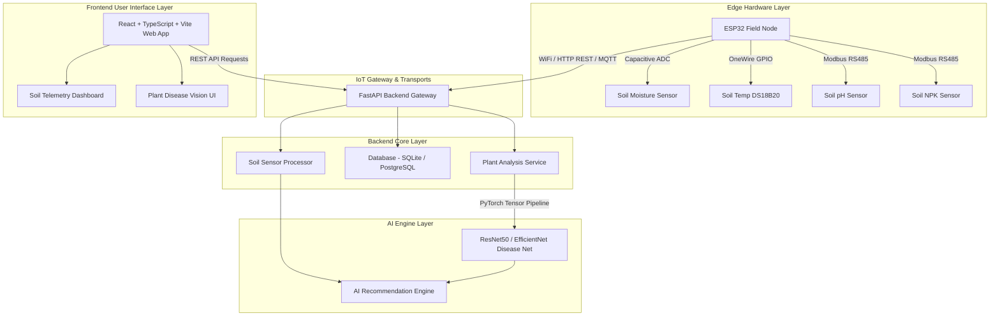

# AI Crop Health - Clean System Architecture Blueprint

## System Overview

The **AI Crop Health** platform is a multi-tier agricultural intelligence system designed to process both physical soil telemetry (via ESP32 IoT edge nodes) and visual leaf health diagnostics (via deep learning computer vision).

## Layer Boundaries & Separation of Concerns

1. **Frontend Layer (`frontend/`)**: Pure UI rendering & state presentation built with React, Vite, TypeScript, and modern CSS. Decoupled from backend implementation details via strongly typed TypeScript contracts (`types.ts`) and modular service wrappers (`services/`).
2. **Backend Layer (`backend/`)**: REST Gateway powered by FastAPI. Coordinates sensor ingestion, request routing, database ORM interactions, and dispatches prediction requests to the AI module.
3. **AI Layer (`ai/`)**: PyTorch deep learning pipeline. Encapsulates neural network models, image pre-processing, augmentation pipelines, and training/inference execution routines.
4. **Hardware Layer (`hardware/`)**: ESP32 C++/Arduino firmware. Manages low-level sensor bus communication (ADC, OneWire, RS485 Modbus), non-blocking sampling loops, and payload transmission.
5. **Database Layer (`database/`)**: Storage abstraction containing SQL DDL schemas and SQLAlchemy ORM models for crops, telemetry readings, plant analyses, and AI recommendations.
6. **Documentation (`docs/`)**: Central system specifications, API contracts, and hardware pinout guides.
